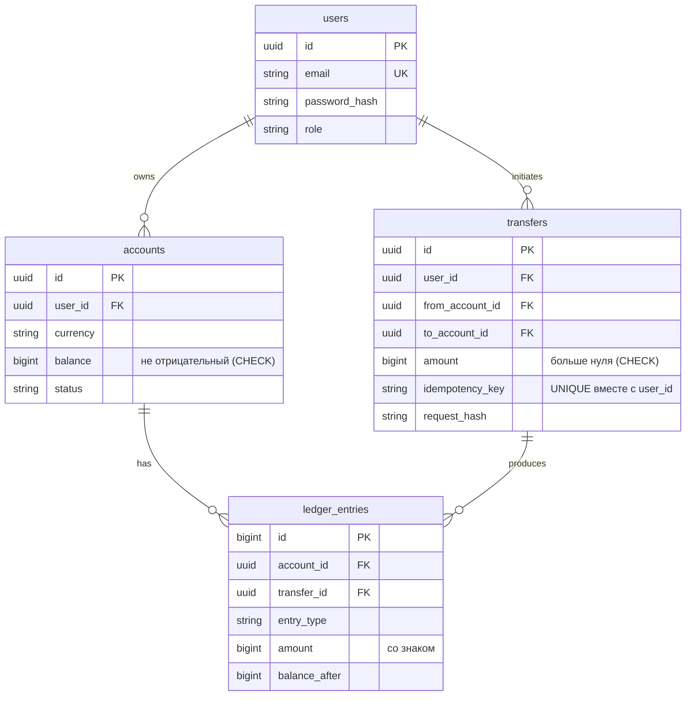

# Mini Bank


Учебный банковский бэкенд на **FastAPI + PostgreSQL**: счета, **атомарные идемпотентные переводы**,
журнал проводок (двойная запись), история операций с пагинацией.

Главная цель проекта — **корректность денег под параллельной нагрузкой**, и это проверяется
тестами: гонки за один счёт, встречные переводы, повторные запросы с одним ключом.

## Что демонстрирует проект

- Транзакции и целостность данных: блокировки строк `SELECT ... FOR UPDATE`, ограничения `CHECK` и `UNIQUE` в БД.
- Идемпотентность платёжного API (`Idempotency-Key`), защита от двойного списания.
- Двойная запись (ledger): сумма проводок по счёту всегда равна балансу.
- Тесты на конкурентность: потоки, реальные блокировки PostgreSQL, проверка отсутствия дедлоков.
- Чистая архитектура слоёв: роутеры → сервисы → модели, единый формат доменных ошибок.
- Инфраструктура: Docker Compose, миграции Alembic, CI на GitHub Actions, JWT-авторизация.

**Стек:** Python 3.10+, FastAPI, SQLAlchemy 2.0, PostgreSQL 16, Alembic, Pydantic v2, PyJWT, argon2, pytest, Docker, GitHub Actions.

## Быстрый старт

```bash
git clone https://github.com/Haydan90/mini-bank.git
cd mini-bank
docker compose up --build
```

API: http://localhost:8000, документация (Swagger): http://localhost:8000/docs.
Миграции применяются автоматически при старте. В Swagger кнопка **Authorize** принимает email и пароль.

Роль администратора получает пользователь, зарегистрированный с email из переменной
`ADMIN_EMAIL` (по умолчанию `admin@example.com`, демо-режим). Только admin может пополнять счета.

### Запуск без Docker

Нужен PostgreSQL с пользователем `bank` / паролем `bank` и базой `bank`:

```bash
python -m venv .venv && source .venv/bin/activate
pip install -r requirements.txt
alembic upgrade head
uvicorn app.main:app --reload
```

Настройки берутся из переменных окружения или файла `.env` (см. `.env.example`).

## Пример сценария (curl)

Суммы везде в **копейках**: `100000` = 1000.00 ₽.

```bash
BASE=localhost:8000

reg() { curl -s $BASE/auth/register -H 'content-type: application/json' \
          -d "{\"email\":\"$1\",\"password\":\"password123\"}" > /dev/null; }
tok() { curl -s $BASE/auth/login -d "username=$1&password=password123" \
          | python3 -c 'import sys,json;print(json.load(sys.stdin)["access_token"])'; }
acc() { curl -s -X POST $BASE/accounts -H "Authorization: Bearer $1" \
          -H 'content-type: application/json' -d '{"currency":"RUB"}' \
          | python3 -c 'import sys,json;print(json.load(sys.stdin)["id"])'; }

# пользователи и токены
reg admin@example.com; reg alice@example.com; reg bob@example.com
ADMIN=$(tok admin@example.com); ALICE=$(tok alice@example.com); BOB=$(tok bob@example.com)

# счета и пополнение счёта Alice на 1000.00 ₽
A_ACC=$(acc $ALICE); B_ACC=$(acc $BOB)
curl -s -X POST $BASE/accounts/$A_ACC/deposit -H "Authorization: Bearer $ADMIN" \
  -H 'content-type: application/json' -d '{"amount":100000}'

# перевод 25.00 ₽ — выполни команду дважды: деньги спишутся один раз
curl -s -i -X POST $BASE/transfers \
  -H "Authorization: Bearer $ALICE" -H 'Idempotency-Key: order-12345-payment' \
  -H 'content-type: application/json' \
  -d "{\"from_account_id\":\"$A_ACC\",\"to_account_id\":\"$B_ACC\",\"amount\":2500}"
```

При повторе вернётся тот же перевод и заголовок `idempotent-replayed: true`. Если отправить тот же
ключ с другой суммой — ошибка `422 idempotency_key_reused`.

## API

| Метод | Путь | Описание |
|---|---|---|
| POST | `/auth/register` | регистрация |
| POST | `/auth/login` | JWT (форма OAuth2 password, `username` = email) |
| POST | `/accounts` | открыть счёт (`RUB` / `USD` / `EUR`) |
| GET | `/accounts`, `/accounts/{id}` | свои счета |
| POST | `/accounts/{id}/deposit` | пополнение, **только admin** |
| POST | `/transfers` | перевод, обязателен заголовок `Idempotency-Key` |
| GET | `/transfers/{id}` | свой перевод |
| GET | `/accounts/{id}/transactions` | история: `limit`, `before_id` (курсор), `entry_type`, `date_from`, `date_to` |
| GET | `/health` | проверка соединения с БД |

Ошибки домена приходят в едином формате: `{"error": {"code": "insufficient_funds", "message": "..."}}`.

## Модель данных



## Как устроен перевод

1. Быстрая проверка: если такой `Idempotency-Key` у пользователя уже есть и тело запроса совпадает, возвращается сохранённый результат.
2. В одной транзакции БД блокируются оба счёта в порядке возрастания `id` (`SELECT ... FOR UPDATE`).
3. Ключ идемпотентности перепроверяется **после** блокировки: параллельный запрос с тем же ключом, ждавший на блокировке, увидит уже закоммиченный перевод.
4. Проверки: владелец счёта-источника, статус счетов, совпадение валют, достаточность средств.
5. Обновляются балансы, создаются запись `transfer` и две проводки в `ledger_entries` (минус у отправителя, плюс у получателя).
6. Коммит. Если сработал `UNIQUE (user_id, idempotency_key)` (редкий случай разных счетов при одном ключе), транзакция откатывается и возвращается результат первого запроса.

Код: [`app/services/transfers.py`](app/services/transfers.py).

## Принятые решения и почему

- **Деньги — BIGINT в копейках.** `float` даёт ошибки округления (`0.1 + 0.2`), целые числа точны.
- **`CHECK (balance >= 0)` в БД.** Даже если в коде появится баг, баланс не уйдёт в минус.
- **Блокировки в порядке `id`.** Два параллельных списания с одного счёта не «потеряют» деньги, а одинаковый порядок блокировок исключает дедлок при встречных переводах A→B и B→A.
- **Идемпотентность через `UNIQUE` + хэш запроса.** Защита от двойного списания при ретраях клиента и сетевых сбоях; тот же ключ с другим телом считается ошибкой клиента.
- **Двойная запись.** Каждое движение денег фиксируется проводкой; инвариант «сумма проводок = баланс» проверяется тестами.
- **Keyset-пагинация** (`before_id`) вместо `OFFSET`: стабильна при появлении новых записей и не замедляется на больших таблицах.
- **Слои:** роутеры только принимают и отдают данные, вся логика в `app/services/`.
- **Синхронный SQLAlchemy.** Проще и достаточно: узкое место здесь — блокировки в БД, а не event loop.

## Тесты

Нужен PostgreSQL (SQLite не подходит: нет `FOR UPDATE`).

```bash
docker compose up -d db          # либо свой локальный PostgreSQL
python -m venv .venv && source .venv/bin/activate
pip install -r requirements-dev.txt
pytest
```

База `bank_test` создаётся автоматически. Всего 27 тестов:

- `tests/test_concurrency.py` — 50 параллельных переводов не теряют копейки; при гонке нельзя уйти в минус (из 20 списаний по 10 при балансе 50 проходит ровно 5); 200 встречных переводов не вызывают дедлок; один `Idempotency-Key` в 10 потоков создаёт ровно один перевод; сумма проводок равна балансу.
- `tests/test_transfers_api.py` — сценарии перевода, ошибки, идемпотентность, пагинация и фильтры.
- `tests/test_auth.py`, `tests/test_accounts.py` — регистрация, авторизация, права доступа, пополнение.

CI (GitHub Actions) на каждый коммит: линтер `ruff`, проверка миграций на чистой БД, `pytest`.

## Структура проекта

```
app/
├── api/          # роутеры и зависимости (авторизация)
├── core/         # конфиг, JWT и хеширование паролей, доменные ошибки
├── db/           # engine и сессия
├── models/       # SQLAlchemy-модели
├── schemas/      # Pydantic-схемы запросов и ответов
├── services/     # бизнес-логика (переводы, счета, авторизация)
└── main.py
alembic/          # миграции
tests/
```

## Что бы сделал дальше

- Rate limiting на `/auth/login` (Redis), refresh-токены.
- Фоновая генерация выписок (Celery + Redis), кэш отчётов.
- Outbox-паттерн и Kafka для событий о переводах.
- Идемпотентность для пополнения, TTL для ключей идемпотентности.
- Метрики (Prometheus) и трассировка.
